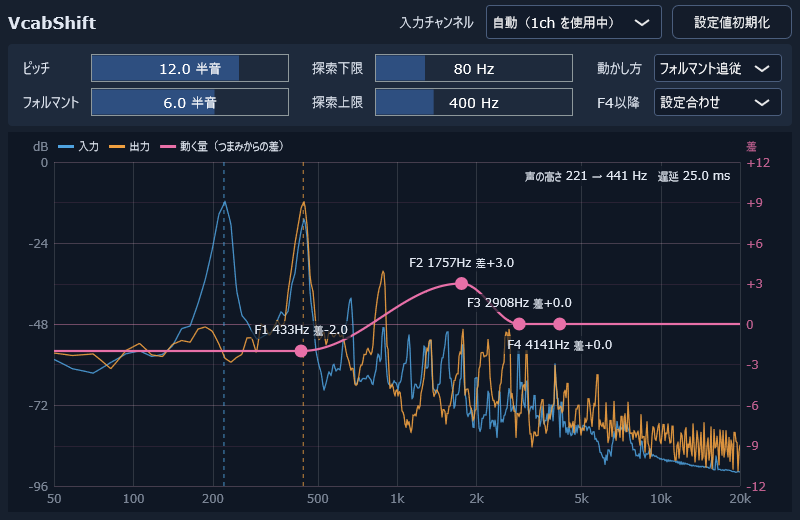

# VcabShift



声の高さ（ピッチ）と声色（フォルマント）を変えるボイスチェンジャーです。TD-PSOLA で、配信やボイスチャットの声をリアルタイムに変えます。

自作のボイスチェンジャー [VoiChanAlgoBox](https://github.com/xelloss120/VoiChanAlgoBox) の「ボイチェン」の段を、ボイチェン専用のソフトとして作り直したものです。フォルマントの動かし方に力を入れています。

| 項目 | 内容 |
|---|---|
| 形式 | VST3 プラグインと、単体で動く EXE 版 |
| 対応 | Windows（64bit） |
| 遅延 | 声の高さを探す範囲の下限の周期 × 2（初期値の 80Hz で 25ms） |
| 負荷 | CPU 1 コアの約 1〜2%（48kHz。音の処理だけ。F1〜F4 の差を付けると増える） |

## できること

| 機能 | 内容 |
|---|---|
| ピッチ | -24〜+24 半音 |
| フォルマント | -24〜+24 半音。断片を伸び縮みさせて動かす（PSOLA の断片の中で済むので、遅延は増えない） |
| F1〜F4 の差 | F1〜F4 の位置ごとに、フォルマントのつまみからさらに ±12 半音動かす。伸び縮みとの差は、包絡の補正で直す。差がすべて 0 なら、どの周波数もつまみの分だけ動く |
| F1〜F4 の位置 | 動かし方が「フォルマント追従」（初期値）なら、声から追いかけた F1〜F4（LPC）。「帯域固定」なら、決まった位置（ドラッグで変えられる）。「一律」なら、点は使わず、どの周波数もつまみの分だけ動かす |
| F4以降 | F4合わせ / 設定合わせ（フォルマントのつまみの分だけ。初期値）/ 地声合わせ（動かさない） |
| ピッチ検出 | YIN（先の音を見ないので、遅延を増やさない） |
| 画面 | 入力と出力のスペクトルに、周波数ごとのフォルマントの動く量（つまみからの差）の線を重ねて出す。F1〜F4 の点を、可変の EQ のようにドラッグして動かす |

グラフの右の目盛りは、フォルマントのつまみからの差です（0 はつまみのとおり）。F1〜F4 の点は、つまみに対して、その位置をさらに何半音動かすかを表します。

- F1〜F4 の点を上下にドラッグします。左右の位置は、声に合わせて動きます（追いかけている間は塗りつぶし、追いかけられないときは白抜き）。
- 動かし方が「帯域固定」のときは、点を上下（差）と左右（位置）にドラッグします。
- ホイールで 0.5 半音ずつ、ダブルクリックで 0 に戻します。

グラフには、声の高さ（入力の青と、変えた後の橙の点線）と遅延も出ます。「設定値初期化」ボタンで、入力チャンネル以外の設定を初期値に戻せます。どの項目も、マウスを乗せると説明が出ます。

## 使うときの注意

**ヘッドフォンで使ってください。** スピーカーで鳴らすと、出た音をマイクが拾って、ハウリング（キーンという大きな音）が起きることがあります。EXE 版は、起動してすぐ音が出るように、入力の消音を初めからオフにしています。

EXE 版の初回は、「オーディオ設定」ボタン（左上の「オプション」の中と同じ画面）から、入力と出力のデバイスを選んでください。マイクの入力チャンネル（1ch / 2ch）は、初期値の「自動」で、音が来ているほうを選びます。

遅延を減らしたいときは、「探索下限」を自分の声の低さに合わせて上げてください（例: 100Hz で 20ms）。下限より低い声は、声の高さを正しく取れなくなります。

## EXE 版を初めて起動するとき

署名をしていないので、ダウンロードした EXE を初めて実行すると、Windows の「PC が保護されました」という青い画面が出ます。次のどちらかで実行できます。

- 「詳細情報」を押してから「実行」を押す
- 実行する前に、EXE（または ZIP）を右クリック → プロパティ → 下のほうの「許可する」にチェック → OK

一度実行すれば、同じファイルでは次から出ません。

## ビルド

必要なもの: Visual Studio 2022（C++ によるデスクトップ開発）、CMake 3.22 以上、Git

```
git clone https://github.com/xelloss120/VcabShift.git
cd VcabShift
git submodule update --init
cmake -S . -B build -G "Visual Studio 17 2022" -A x64
cmake --build build --config Release
```

- `C:\src` のような浅い場所に置いてください。深い場所だと、Windows のパスの長さの制限で、clone やサブモジュールの取得が失敗することがあります。
- サブモジュールは JUCE だけです。
- CMake は、Visual Studio に同梱のものも使えます（「Developer PowerShell for VS 2022」から実行すると、`cmake` コマンドが使えます）。

できるもの:

| ファイル | 内容 |
|---|---|
| `build/VcabShift_artefacts/Release/VST3/VcabShift.vst3` | VST3 プラグイン（フォルダ。フォルダごとコピーして使う） |
| `build/VcabShift_artefacts/Release/Standalone/VcabShift.exe` | EXE 版 |
| `build/vcabsh_render_artefacts/Release/vcabsh_render.exe` | 開発用の WAV 処理ツール |
| `build/vcabsh_shot_artefacts/Release/vcabsh_shot.exe` | 開発用の画面の撮影ツール（WAV を流しながら、プラグインの画面を PNG に書き出す。この README の画像もこれで作った） |

## 開発用のツール

`vcabsh_render` は、WAV ファイルにプラグインと同じ処理をかけて書き出します。設定は `キー=値` で渡します（キーは `Source/Core/Params.cpp` の一覧）。

```
vcabsh_render in.wav out.wav pitch=12 formant=6 --align
vcabsh_render in.wav out.wav f2_delta=3 warp_mode=2 --track track.csv
```

- `--align`: 遅延の分を詰めて、入力と時刻をそろえる
- `--track`: 5ms ごとの声の高さと F1〜F4 を CSV に書く

`Tools/Regression/regress.py` は、合成の母音をいくつかの設定で処理し、出力が基準とビット単位で一致するかを確かめます（`make` で基準を作り、`check` で比べる。`eval` で、声の高さと、写像どおりに動いたかの数値を出す）。`Tools/Icon/make_icon.py` は、アイコンを作ります。

## ライセンス

Copyright (C) 2026 x120

[AGPLv3](LICENSE)（AGPL-3.0-only）。使っているライブラリ（JUCE など）のライセンスは [THIRD_PARTY_LICENSES.md](THIRD_PARTY_LICENSES.md) にまとめています。ASIO SDK を GPLv3 で使っているため、GPLv3 の本文を [LICENSES/GPL-3.0.txt](LICENSES/GPL-3.0.txt) に置いています。

アイコンの図柄は VoiChanAlgoBox のアイコン（同じ作者）を使っています。文字は Noto Sans Bold（SIL Open Font License）です。

VST is a trademark of Steinberg Media Technologies GmbH, registered in Europe and other countries.
